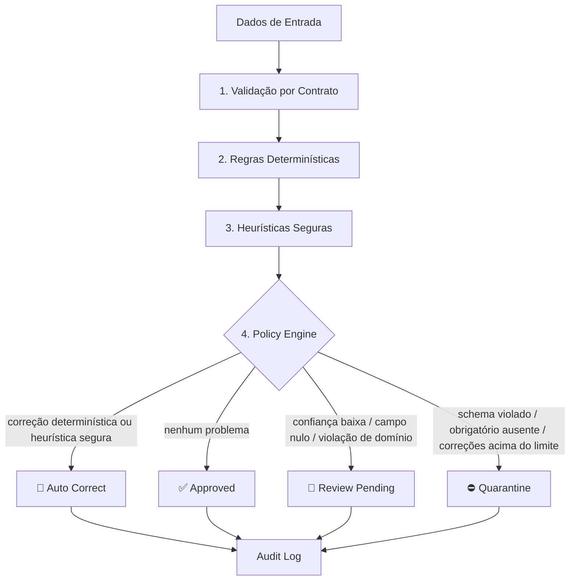

# Self-Healing Governado

> **Remediação inteligente de inconsistências com regras, heurísticas, política de decisão e rastreabilidade auditável.**

## Visão Geral

O **Self-Healing Governado** é uma solução de qualidade de dados que vai além da validação tradicional. Em vez de apenas identificar erros, a solução classifica cada inconsistência e decide o melhor tratamento operacional:

- ✅ **Approved** — Registro válido, pronto para consumo.
- 🔧 **Auto Correct** — Correção automática quando segura (regras determinísticas + heurísticas de alta confiança).
- 👀 **Review Pending** — Envio para revisão humana em casos ambíguos.
- ⛔ **Quarantine** — Bloqueio de registros com inconsistências críticas.

A IA/LLM, quando usada, é uma camada **complementar** — nunca a autoridade que decide. Quem decide é uma política explícita, determinística e versionada.

## Arquitetura

```
Dados de Entrada
    → Validação por Contrato (schema + campos obrigatórios + domínio)
    → Regras Determinísticas (normalização segura)
    → Heurísticas Seguras (inferência com score de confiança)
    → Policy Engine (decisão operacional)
    → Audit Log (rastreabilidade completa)
```




## Estrutura do Projeto

```
Self-Healing Governado/
├── src/quality_audit/
│   ├── contracts/
│   │   ├── contract_loader.py             # Carregador de contratos YAML
│   │   └── pessoa_fisica.yaml             # Contrato de pessoa física (schema + domínio + owners)
│   ├── validators/
│   │   ├── schema_validator.py            # Validação de tipos
│   │   ├── required_fields_validator.py   # Campos obrigatórios
│   │   └── domain_validator.py            # Regras de domínio (CPF, UF, etc.)
│   ├── rules/deterministic_rules.py       # Correções determinísticas (trim, CPF, UF, e-mail)
│   ├── heuristics/heuristic_engine.py     # Heurísticas com score de confiança
│   ├── policy/policy_engine.py            # Motor de decisão (Approved/Auto Correct/Review/Quarantine)
│   ├── audit/audit_logger.py              # Auditoria operacional (timestamp, hash, owner, linhagem)
│   ├── governance/
│   │   ├── ownership.py                   # Resolução de ownership por campo/regra
│   │   └── policy_registry.py             # Registro de políticas + hash SHA-256 de versão
│   ├── enforcement/continuous_enforcer.py # Monitoramento contínuo de pasta de entrada (thread)
│   └── orchestrator.py                    # Orquestrador do pipeline completo
├── frontend/
│   ├── app.py                             # Dashboard Streamlit (ROI, fila de revisão, linhagem, governança)
│   └── fluxo_decisao.html / .png          # Diagrama visual do fluxo de decisão
├── notebooks/
│   ├── 01_run_self_healing.py             # Pipeline principal (batch)
│   ├── 02_review_pending_dashboard.py     # Listagem de pendências de revisão
│   ├── 03_cost_monitoring.py              # Monitoramento de custos / ROI
│   ├── 04_valida.ipynb                    # Notebook de validação exploratória
│   └── 05_continuous_enforcement_demo.py  # Simulação do enforcement contínuo ponta a ponta
├── tests/                                 # Testes automatizados (pytest)
├── config/settings.yaml                   # Configuração global (thresholds, caminhos, logging)
├── pyproject.toml                         # Configuração do pacote
├── requirements.txt                       # Dependências
└── README.md
```

## Como Executar

### Instalação

```bash
# Instalar o pacote em modo editável
pip install -e .

# Ou via requirements.txt
pip install -r requirements.txt
```

### Pipeline em batch

```bash
# Executar pipeline principal
python notebooks/01_run_self_healing.py

# Revisar pendências
python notebooks/02_review_pending_dashboard.py

# Monitorar custos / ROI
python notebooks/03_cost_monitoring.py
```

### Enforcement contínuo (demo)

```bash
# Simula o monitoramento contínuo de uma pasta de entrada,
# processando lotes à medida que chegam
python notebooks/05_continuous_enforcement_demo.py
```

### Dashboard (Streamlit)

```bash
streamlit run frontend/app.py
```

O dashboard expõe quatro frentes: visão executiva com ROI estimado de automação, fila de revisão manual, rastreabilidade por registro (linhagem) e catálogo de governança/ownership.

### Testes

```bash
pytest
```

### No Databricks

Importar os notebooks e configurar como Databricks Job com parametrização (Delta Tables + Unity Catalog).

## Princípios de Design

1. **Contratos como fonte de verdade** — Toda validação é baseada em contratos YAML versionados e assinados (hash SHA-256).
2. **Correção segura** — Somente regras determinísticas e heurísticas de alta confiança (≥ 0,85) aplicam auto-correção.
3. **Revisão humana para ambiguidades** — Casos com baixa confiança vão para fila de revisão, com a sugestão já anexada.
4. **Quarentena para riscos** — Registros com erros críticos, ou com volume de correções acima do limite, são bloqueados antes do consumo.
5. **Auditoria completa** — Toda decisão é registrada com timestamp, versão/hash da política e evidência de linhagem.
6. **Ownership por campo** — Cada campo do contrato pode ter um responsável (ex.: CPF → jurídico, renda → financeiro), usado para roteamento de exceções.
7. **LLM complementar** — A LLM pode ser usada como camada complementar, nunca como autoridade principal.

## 📬 Meus Contatos!
Quer bater um papo, trocar ideias, ou só dar aquela stalkeada básica? Não seja tímido! Aqui estão meus canais de comunicação preferidos:

🌐 LinkedIn — O lugar onde pareço super profissional e sério. 😉
🐙 GitHub — Aqui é o cantinho dos meus códigos! Dá uma espiada, mas cuidado com os bugs. 😂

## Licença

Uso interno corporativo.
